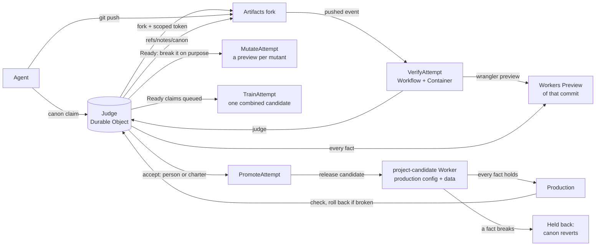

# Canon

**Main is not a branch. Main is the set of facts that must stay true of the running app.**

The repo is still Git and the agent still pushes. The only new object is the fact that decides whether that
push becomes main.

Canon is a small protocol on top of [Cloudflare Artifacts](https://developers.cloudflare.com/artifacts/)
for many coding agents sharing one codebase. Agents don't merge branches or open pull requests. Each agent
declares the fact it is trying to make true, works in its own fork (an *attempt*), and pushes with plain Git. A
judge checks every fact (a plain sentence with an automated check) against a live Workers Preview of that attempt. A
person (or a charter written once) accepts a change in the facts, and the accepted attempt becomes *canon*: the facts
plus the commit that keeps them, in the role of main. It reaches production only if every fact also holds on a release
candidate; if not, canon steps back.

**The idea, in one line: agents propose changes, protected facts govern integration, and release evidence decides
what reaches production.** Coordination, review and conflicts are all judged the same way, against the declared facts on
the combined code; every decision, and the evidence it stood on, is recorded where anyone can check it
([evidence map](#evidence-map)).

- **Coordination**: agents read claims ("agent-4 is trying to make *sold-out items can't be bought* true"), not file locks.
- **Conflicts**: caught on behaviour, not text. Overlapping edits that keep the facts are fine (the judge replays an
  attempt onto the new canon itself, and repairs a text conflict with a model when it can; the facts still decide). A clean merge that breaks a fact is
  not. Before a push, `canon overlap` names the other attempts changing the same functions as you, and what each is
  building (a hook tells agents as they edit).
  Two attempts that build the same behaviour opposite ways get a heads-up while they are still being written,
  are flagged as a clash once both are Ready (before anyone accepts either), and once one lands, the other is
  re-applied on top of it and the combined code decides.
- **Review**: the fact diff. Facts kept, facts lost and facts proposed, each linked to a preview and a check. The
  judge also tests the checks: it breaks each Ready change on purpose and shows which break no fact noticed. Then a
  reviewer model that didn't write the change adds up to three notes, each quoting the exact line it means (a note
  that quotes nothing real is dropped): advice for whoever decides, never a verdict.
- **Release**: accepted is not released. Every release runs all facts on a full release candidate (production's
  config, its own long-lived data) first, a version that breaks one is held back, and canon always equals what
  production runs: a held-back release reverts it.
- **Throughput**: on autopilot with `"batch": true`, claims that queue behind a release leave together as one merge train: one candidate, checked once,
  released once. A train that doesn't hold splits in halves (four or more riders) or goes one by one, so a failure is
  narrowed down in a few checks (as diagnosis: a break that needs two riders together shows up when the second lands on
  the first). Trains are
  speculative: the next one is built and checked on the canon still being released, and lands the moment it ships.
- **Why**: the fact chain. Every fact links to the attempt that made it true and to the attempts that failed it.
  Failed attempts stay clonable, so they remain the project's memory. The chain is in Git too, as notes on the canon
  commits: `git clone https://canon.rodeo/p/farmstand.git`, fetch `refs/notes/canon`, then `git log --notes=canon`.

The facts live in the repo as `canon.json`, so the canon survives outside Cloudflare. A fact works like a
required check in branch protection, but it checks behaviour on a live preview. As in a merge queue, only a tested
tree lands; unlike one, the checks are facts the agents can't edit, and people review changes to the facts instead
of code. Probes draw random inputs from a seed the judge picks after each push (recorded in the verdict), and canon's
facts are re-checked on production every hour. A person pushing by hand is just another attempt and gets the same verdict. You can start from an existing
Git repo by importing it.

See [PROTOCOL.md](PROTOCOL.md) for the four moves. To be the maintainer yourself, open the
[demo](https://canon.rodeo/demo): accept a Ready fact and watch the judge re-apply the rest on the new canon (the one
that clashed is settled on the combined code), or switch on autopilot and watch merge trains leave (it runs in your
browser on sample data). To feel the difference, play
[Canon Stampede](https://canon.rodeo/game): ride a stampede of agents' changes for 40 seconds reviewing every
change yourself, then 40 the Canon way.

## Evidence map

Every claim in this README, with where to check it. **Recorded** links are real records from canon.rodeo (projects
left up for inspection); **simulated** results come from a local harness; **unit-tested** behaviour is in `npm test`.

| Claim | Evidence | Reproduce |
|---|---|---|
| Conflicts are judged on the combined code, not the text | the Oct 12 run ([farmstand stats](https://canon.rodeo/p/farmstand/stats)): a clash flagged before either side was accepted, the loser re-applied and judged; the [demo](https://canon.rodeo/demo)'s tour, step 1 (simulated in the browser) | `node scripts/baseline.mjs` ([docs/baseline.md](docs/baseline.md)) |
| A check that didn't run is never a pass | recorded: [evid #2](https://canon.rodeo/p/evid/canon/2/acceptance) (review unavailable, owner exception named), [evid #5](https://canon.rodeo/p/evid/canon/5/acceptance) | `node scripts/test-evidence.ts` |
| Every canon has an acceptance record, also in Git notes | recorded: any `/p/<project>/canon/<n>/acceptance`; `git fetch https://canon.rodeo/p/rehearse.git refs/notes/canon` | |
| A change that passes its preview but breaks on existing data never reaches production | recorded: [rehearse #7](https://canon.rodeo/p/rehearse/canon/7/acceptance) (data migration the previous version can't read); simulated: [docs/benchmark.md](docs/benchmark.md), data workload | `node scripts/benchmark.mjs --workloads data` |
| Rollback compatibility is compared on the exact state each version wrote, and missing evidence holds the release | recorded: [rehearse #13](https://canon.rodeo/p/rehearse/canon/13/acceptance) (two facts with no read-back: unavailable, held), [evid #5](https://canon.rodeo/p/evid/canon/5/acceptance) (an owner released over it; `recovery.override` names it) | `node scripts/test-probe.ts`, `node scripts/test-evidence.ts` |
| A flaky release is taken back out at 10% | recorded: [canary #3](https://canon.rodeo/p/canary/canon/3/acceptance) | `node scripts/benchmark.mjs --workloads stateless` |
| One writer of production, behind a lease (republishes included) | unit-tested: `scripts/test-release.ts`; the `fence:` step every release takes before each Worker-changing step ([docs/timings.md](docs/timings.md)) | `node scripts/test-release.ts` |
| Duplicates are superseded, prerequisites wait, merge trains release once | deployed run: [docs/e2e.md](docs/e2e.md), records [convoy #2](https://canon.rodeo/p/convoy/canon/2/acceptance) and [convoy #3](https://canon.rodeo/p/convoy/canon/3/acceptance); simulated: [docs/benchmark.md](docs/benchmark.md), coordination workload | `node scripts/e2e.mjs`, `node scripts/benchmark.mjs --workloads coordination` |
| Where the time goes, and what was changed because of it | [docs/timings.md](docs/timings.md), from Cloudflare's own Workflows records | `node scripts/timings.mjs` |
| Held-out checks stay private | recorded: `rehearse` (the board shows the sentence, never the check); the API redacts details | |

Nothing here needs a secret to read. Held-out checks and keys are never in a public record.

**Which code made which record.** The judge was redeployed as fixes landed, so each headline record names the judge
version (Cloudflare Worker version) that produced it and the commit it was deployed from:

| Record | Judge version | Commit |
|---|---|---|
| [rehearse #13](https://canon.rodeo/p/rehearse/canon/13/acceptance) (held: no read-back), [evid #5](https://canon.rodeo/p/evid/canon/5/acceptance) (owner override) | `22e54713`, deployed Oct 13 18:02 UTC | `b9f3a2c` |
| [convoy #2](https://canon.rodeo/p/convoy/canon/2/acceptance), [convoy #3](https://canon.rodeo/p/convoy/canon/3/acceptance) (the deployed run, [docs/e2e.md](docs/e2e.md)) | `a83d0b92`, Oct 13 18:41 UTC | `4c84499` |
| everything after Oct 13 20:19 UTC | `118c6f12` | `79de603` |
| earlier records (Oct 12–13: farmstand, rodeo, evid #2–3, rehearse #2–12, canary) | earlier versions | before `b9f3a2c` |

Two rules changed after the convoy run, so a stateless release judged today would differ: a zero-comparison
rehearsal now also needs the owner's `"state": "none"` declaration (convoy's records say "no storage bindings" alone),
and the production-write barrier now covers direct deploys.

## How Cloudflare is used

| Piece | Role in Canon |
|---|---|
| **Artifacts** | every attempt is a Git fork with a scoped token; canon is a repo; Canon serves its own source and the fact chain (Git notes) from it |
| **Workers** | the judge's HTTP API, MCP endpoint, board and site (canon.rodeo); the apps it judges are Workers too |
| **Durable Objects** | one judge per project: claims, verdicts, canon, leases and acceptance records in its SQLite; synchronous storage makes accept and release decisions atomic; a second Durable Object shares verification capacity across projects |
| **Workflows** (+ `@cloudflare/ci` Containers) | verify, mutate, re-apply, merge train and release pipelines; every step's timing is in the platform's records ([docs/timings.md](docs/timings.md)) |
| **Workers Previews** | one live preview per pushed commit, where every fact is checked |
| **Workers deployments API** | versions uploaded at 0%, smoke-tested with version overrides, rolled out by percentage; only the judge writes it |
| **Workers AI** | the reviewer (Kimi K2.7 Code) and the conflict repair model; never the judge |

## One real run

On Oct 12, 2026, twelve Claude Code agents worked on the farmstand demo at once on canon.rodeo, with a person deciding,
while six more ran a second project (rodeo) on autopilot. On farmstand the judge ran 465 fact checks, rejected 2
attempts without anyone reading the diff, caught 1 clash before anyone accepted either side, and re-applied 8 attempts
on the new canon by itself; the median push-to-verdict was 48 s (p90 77 s). A person clicked once,
to accept one side of the clash (*no double booking*). The other side wasn't rejected on the warning: the judge
re-applied it on the new canon, hit a text conflict in `src/index.ts`, and handed it back to its agent; the other
Ready attempts it re-applied came back Ready.
On rodeo, nobody clicked: queued claims left in 2 merge trains (5 facts), and the release gate held back 2 releases. A
schema change passed its fresh preview but broke the market page on a release candidate with real data; when its train
was held back, its riders landed one by one, and the gate found it.

The same farmstand attempts through plain `git merge`: 6 of 13 merged cleanly, and the merged app charges the wrong
price (a bulk discount nobody approved merged without a conflict and broke "The basket charges the listed price"). The
other 7 stopped at text conflicts for a person to resolve. A conventional merge queue that also gates each attempt on
the repo's CI (type-check, lint) and the author's own test on the merged tree lands the same 6 and ships the same bug:
the discount's own test passes, because the discount is what its author meant. Reproduce it with `node scripts/baseline.mjs`; the report is
[docs/baseline.md](docs/baseline.md). Canon's own numbers come from the judge's records, live at [canon.rodeo/p/farmstand/stats](https://canon.rodeo/p/farmstand/stats) and [canon.rodeo/p/rodeo/stats](https://canon.rodeo/p/rodeo/stats).

What it cost: every verification, deliberate-break run, re-apply, merge train and release in the run took 84 minutes
of Cloudflare Workflows time in all (64 verifications, 40 mutation runs, 27 re-applies, 2 trains, 4 releases, by the
platform's own instance records). Counted as a fully busy `standard-4` container for every second at list price, that
is about $0.56 for the whole run, under a cent per verification. Those counts are Workflows instances, retries and
setup included, so they run higher than the judge's own records (59 verdicts, 26 mutation runs in the two stats pages).
The judge's stats keep a running `computeUsdEstimate` of the part it times itself (push to verdict and timed mutation
runs; $0.33 for the run), which is why it's lower than the full Workflows total.

One run is evidence, not a benchmark.

## Load test: 30 pushes at once

Thirty agents' attempts on a throwaway project each pushed a commit within the same second (autopilot off, so every
push is a pure verification: a container install, a Workers Preview, the command facts, every probe). Same 30 commits,
three judge configurations:

| Verification slots per project | Verdicts | Platform errors | First | Median | p90 | Last |
|---|---|---|---|---|---|---|
| unlimited | 3 in the first 10 minutes | the other 27 hit "RPC session was shut down" or subrequest-depth errors, and the judge's retries failed again | | | | |
| 10 | 30 | 3 (retried) | | 803 s | 879 s | 904 s |
| **6** (the default now) | **30** | **0** | 48 s | 115 s | 215 s | 231 s |
| 6, repeated on a second project | 30 | 0 | 42 s | 134 s | 226 s | 235 s |
| 4 | 30 | 0 | 38 s | 156 s | 298 s | 331 s |
| 8 | 30 | 0 | 48 s | 165 s | 240 s | 257 s |
| 6, with **60** pushes at once | 60 | 0 | 56 s | 340 s | 592 s | 652 s |

With no limit the platform buckles. At 10, a few builds stuck in platform retries hold their slots and the queue backs
up. At 6, every push gets a real verdict in under four minutes, and a repeat on a second project agreed. Fewer slots (4)
waste capacity; more (8) contend and are slower too. At 60 pushes the queue simply runs twice as long: every one still
got a real verdict, the last in under 11 minutes. So the judge admits six verifications per project at a time and
queues the rest in their own Workflows (`admit` in referee.ts).

**Landing under load, not just verifying.** Thirty attempts on autopilot (merge trains on) raced to land eight backlog
facts, all pushed in the same second. The first merge train landed five facts after 9 minutes. The other three facts'
attempts all edited the same request handler as that train, and all eleven hit text conflicts when the judge re-applied
them: with scripted agents that can't resolve conflicts, they stalled. That's what bounded repair is for (see
PROTOCOL.md): with it, the repair model resolved ten of those conflicts, every repaired attempt passed every fact, a
second train landed two more facts, and, after one more fix (a repaired attempt that fell behind again wasn't being
re-applied), the last one landed alone. In all: eight of eight facts, three releases, no wrong rejections, nothing held
back, 14 attempts re-applied by the judge, 9 of them repaired.

Then the same test again on a fresh project, with both fixes in and nobody touching it:

| Run | Facts landed | Time to all landed | Releases | Wrong rejections | Held back | Re-applied by the judge | Repaired (peak) |
|---|---|---|---|---|---|---|---|
| 1 (repair built mid-run) | 8 of 8 | (stalled, then fixed) | 3 | 0 | 0 | 14 | 9 |
| 2 (untouched) | **8 of 8** | **21 min** (3 at 7 min, 5 at 12, 7 at 18, 8 at 20) | 4 (trains of 3, 2, 2, then one alone) | **0** | **0** | 31 | 6 |

Run 2's compute, from Workflows' own records: 143 workflow runs, 161 minutes of work once their time waiting in the
queue is taken out (13,876 s of wall time, 4,230 s of it queued): about 20 container-minutes per landed fact, and at
most $1.07 for the run (every busy second priced as a fully busy `standard-4` at list price), so about 13 cents per
landed fact. Still one project and scripted agents: the next measurement is real agents, more of them.

The same 30 attempts through a conventional merge queue (`node scripts/queue-under-load.mjs`: same changes, same
order; an attempt lands only if it merges cleanly and the repo's CI and its author's own test pass on the merged
tree): **5 of 8 features land**, 11 attempts bounce to a person on text conflicts (stall products, double booking and
basket removal never land), and 14 merges are redundant copies of a feature already in, because a queue doesn't know
two attempts are building the same thing. Canon on that workload: 8 of 8, nobody involved, duplicates superseded.

One thing the load did break: under it, a correct change missed the 400 ms page-speed fact (p95 1.7 s) and was
rejected. Now a speed fact that fails also runs on canon's own preview at that moment; if canon is just as slow, the
verdict is a platform error the judge retries, not a rejection. Not measured yet: hundreds of agents, or several busy
projects sharing one account's container limit.

## Where the time goes

`scripts/timings.mjs` reads every verification, release and deliberate-break Workflow's step times from Cloudflare's
own records ([docs/timings.md](docs/timings.md)). On the push-to-verdict path an agent waits on, the preview upload
(median 18 s), the dependency install (17 s) and the command facts (9.5 s) were the three longest steps, and the
preview and the command facts ran one after the other although they need nothing from each other: they now run side
by side. Observed afterwards (not a controlled experiment: different attempts, and a small sample): build to verdict
went from a median of 54 s to 48 s, and p90 from 79 s to 60 s (same day, 46 verifications before, 28 after). Releases spend most of their time deploying the release candidate (22 s median) and checking it
(26 s, including a 20-second settle while Durable Objects pick up new code); the canary's holds are policy, not
overhead. What wasn't changed, and why: the install cache is per attempt, because every attempt is its own repo, and
sharing a cached workspace between attempts would carry one agent's files into another's checkout.

## Live tests after the run

The features built after the Oct 12 run were each tested live on throwaway projects on canon.rodeo the same day
(deleted afterwards, so the boards above stay as the run left them):

- **Heads-up**: agent-2's unfinished double-booking guard (it refused a second booking with 400 instead of 409) and
  agent-3's shared stalls were flagged to both agents while agent-2 was still unproven; when agent-2 finished, the
  heads-up became a clash.
- **Reviewer**: on a Ready booking change, the reviewer model's notes pointed at the guards no fact covered, each quoting
  its line. Getting there took three tries: Llama 3.3 returned nothing, and Kimi needed room to reason.
- **Overlap, while editing**: a real Claude Code session with the overlap hook (its first, file-level version) edited `src/index.ts` in a farmstand
  attempt and was told, unasked, which other agents in flight were changing the same file and what each was building
  (and wasn't told again on the next edit, since nothing had changed). In a single-file app that lists everyone (from
  the load test below, all 29 others), so overlap now goes down to functions: with four agents on one file, the one
  adding a sold-out guard was told exactly one name, the agent adding a line limit to the same `Market.addToCart`, and
  the two changing `fetch` were folded into one line. A real Claude Code session with the current hook, editing
  `addToCart` there, was told unasked that agent-2 was changing `Market.addToCart` to enforce the 99-unit limit, and
  judged its own edit wouldn't conflict.
- **An agent acting on it**: with agent-1's 99-unit line limit pushed, a real Claude Code session (Sonnet, the hook on)
  was asked only to add a route that puts 150 dozen eggs in the basket via `market.addToCart`. The hook told it
  agent-1 was changing `Market.addToCart` for "a single basket line can't exceed 99 units"; before any push, it worked
  out that the two features are mutually exclusive for one product (one basket line can't hold 150 once the cap lands)
  and said so, instead of quietly splitting the call. That's a semantic conflict raised by the agents themselves,
  before either had a verdict.
- **Calls**: one agent capping a basket line at 99 (changing `Market.addToCart`) and another moving the add-to-basket
  route into a helper that calls `market.addToCart(...)`: each was told about the other, from its own side ("calls
  Market.addToCart, which you are changing" / "is changing Market.addToCart, which your change calls").
- **Queue**: with one slot busy, an attempt pushed twice: the first push waited, then dropped itself as stale once the
  second arrived; the second waited its turn and ran. With one slot busy, an agent-proposed fact queued first and a
  backlog fact people wrote queued 11 seconds later: the backlog fact got the next slot (2 turns waited, against 6).
- **Speculative train**: two riders became Ready while canon #5 was releasing; the train was built and checked on #5
  during that release and landed with both as soon as it shipped.
- **Bisection**: a train of four, one with a schema change that breaks on existing data, was held back at release. It
  split; the clean half (two facts) shipped; the other half was held again; alone, the schema change was held and
  named, and its partner shipped. Canon stepped back with every hold.

- **Required evidence** (Oct 12, evening, on a test project, `evid`, left up so its records can be inspected;
  charter `{"mutation": 0.5, "reviewRisk": true}`): a command fact waited for the owner ("deliberate breaks are only
  judged by probe facts"; before, it waited forever with a misleading message). A product page whose change also
  dropped a table had its review fail with Workers AI out of capacity: unavailable, so it waited for the owner, and
  the judge flagged the `DROP TABLE` as destructive. Accepted by the owner anyway, its
  [acceptance record](https://canon.rodeo/p/evid/canon/2/acceptance) names both exceptions and says a failed release
  won't be rolled back automatically; the release Workflow checked the commit against it before deploying, and the
  Git note on that canon commit carries it. A line limit with every piece of evidence passed landed on autopilot with
  no exceptions ([record](https://canon.rodeo/p/evid/canon/3/acceptance)). A stall-products route that put the URL
  into SQL was flagged by the reviewer (a SQL injection, quoting the line) and waited; re-applied by the judge after
  canon moved, it was flagged again on its own.
- **A race**: a concurrent step (8 bookings of one stall at once, exactly one may win) held on farmstand's production
  booking code, which an agent wrote in the run.
- **Rollback rehearsal** (a second test project, `rehearse`, on autopilot): a stall-booking change (a new table and
  inserts) was rehearsed before production: the previous version kept all 6 of its facts on the data the new code
  wrote, so it shipped marked rollback-safe ([record](https://canon.rodeo/p/rehearse/canon/2/acceptance)). A change
  that moved sold-out goods into their own table (a `DELETE FROM products`, not a schema change, so no pattern would
  flag it) passed every fact, but the rehearsal showed the previous version listing 5 products, not 6, on the migrated
  data: autopilot held it back, production never ran it
  ([record](https://canon.rodeo/p/rehearse/canon/7/acceptance), with the candidate rebuild).
- **Rehearsal with state continuity, and the judge writing production** (`rehearse`, canon #10): the release uploaded a
  version of a Durable Object app and the judge put it at 100% (no `wrangler deploy` from the run); the rehearsal kept
  all 8 previous facts, and compared reads on the state the new code wrote with reads on the state the old code wrote
  ([record](https://canon.rodeo/p/rehearse/canon/10/acceptance)).
- **Held-out facts** (`rehearse`): the owner's "a basket line can never hold a negative quantity" was refused, because
  canon breaks it (an earlier test change allows it); "adding the same product twice adds the quantities up" was
  stored, and agents see it with no check. A change that quietly made a repeated add overwrite instead was rejected,
  its verdict saying only that a held-out fact broke.
- **Prerequisites** (`rehearse`): a product page declared `after` search-by-name; Ready, it waited ("it builds on
  'Shoppers can search products by name', which isn't canon yet"). When search-by-name landed (canon #12, its
  rehearsal now read-only: the old version kept all 11 facts and read back the new version's writes in 6 comparisons),
  the judge re-applied the product page on top, and the combined code failed the linter (the request handler grew too
  complex with both features): the dependency resolved, and the combination judged on its own.
- **Gradual rollout** (a third test project, `canary`, a stateless Worker): a correct change went out at 10%, then 50%,
  then 100%, no failures on either version ([record](https://canon.rodeo/p/canary/canon/2/acceptance)). A change with
  an upstream lookup failing one request in eight passed its preview, its release candidate and the 0% smoke test
  (every check passes on a retry), and an owner accepted it ("item pages are wanted for the shop", kept as the reason);
  at 10% the canary's raw requests failed 4 of 40 on the new version against 0 of 40 on the old, so it was taken back
  out and held, and production never served it to more than a tenth of requests for 45 seconds
  ([record](https://canon.rodeo/p/canary/canon/3/acceptance)). Real traffic per version came from Cloudflare's
  analytics too (68 requests on the new version, 40 on the old), but those count exceptions, not 503s the app returns:
  why the raw requests are there.
- **Specialist review and stronger breaks** (`evid`): a booking change (a new table and inserts) was reviewed in two
  passes, general and data, with its coverage recorded (one file, shown around its changes); the data specialist
  pointed at a `DROP TABLE` that runs every time the object starts. The new breaks (a dropped uniqueness constraint,
  a retry that overwrites, a migration that isn't re-runnable) got past its facts: 2 of 5 caught, under the charter's
  50%, so it waited for the owner.
- **Scope**: a claim that declared `src/index.ts` and also edited `README.md` waited for the owner ("outside the files
  its claim said it would touch"); one that stayed in scope landed, its record saying so
  ([record](https://canon.rodeo/p/rehearse/canon/9/acceptance), which also lists the alternatives it passed over).

- **The fixture contract, live** (Oct 13): on `rehearse`, an agent's stall-products change landed on autopilot as
  canon #13 and was rehearsed: 6 facts compared (the previous version read back, by the ids it saved, what the new
  version wrote, beside what it wrote itself), 1 not applicable (its only write is refused), and 2 unsupported: the
  booking and line-limit facts write state and have no GET step to read it back. Unsupported is missing evidence, not
  a pass, so the rehearsal was unavailable and autopilot held the release; production never served it, and the record
  says which facts need a read step ([record](https://canon.rodeo/p/rehearse/canon/13/acceptance)). On `evid`, the
  owner accepted search-by-name over an unavailable review; its rehearsal was unavailable for the same reason, and it
  went out on the owner's authority with `recovery.override` naming exactly that
  ([record](https://canon.rodeo/p/evid/canon/5/acceptance)).

What broke in those tests, and is fixed: the first end-to-end run on a brand-new project (`relay`, Oct 13) passed
its merge train, release candidate and rehearsal, then couldn't upload its first version, because Cloudflare won't
upload a version of a Worker that doesn't exist yet; the release was held back and canon stepped back, as it should,
and a project's first release now deploys directly (there is nothing in production to stage beside). `relay`, left
on autopilot, had been held back twice on it (canon #2 and #4, each reverted); after the fix it landed all four facts
by itself (canon #6 to #8), with no clicks. Earlier: the first line-limit attempt was flagged by the reviewer (two adds of 50 and
60 make a line of 110) and waited, but its re-apply drew a review without that risk and landed, so a risk named on an
attempt now stands on its re-applies until an agent changes the code (deployed; in the live retest the reviewer named
the risk again itself, so that rule didn't have to act). Two reviews were cut off by a deploy and sat at "reading"
(a stuck review is now retried once, and the wait is re-checked when it would time out; the retry finished and named
the SQL injection). The first held-back data migration left the release candidate's data in a shape production
never had, and the next, correct, release was held back on it (it's in that release's alternatives above); a release
that touched data and didn't ship now rebuilds the candidate from production's code, and the next correct release
shipped. Earlier: a freshly deployed release candidate answered one check with a 500 and held
back a correct release (it now settles for 20 s, and a fact must fail every time over ~45 s); a production URL that
Cloudflare's edge answered with 530 rolled back a correct release (edge statuses never count against the code now);
retrying every failing fact on a candidate ran into a platform RPC failure and left a release unrecorded (the check
stops at the first consistent failure, and an unrecorded release is resolved on production); the "held back twice"
valve counted a train's hold against each rider (only solo releases count); and an API error page during a build
rejected a correct change (platform failures are retried, never rejections).

## How it compares

| | Merge queue | AI review of the diff | Held-out tests | Canon |
|---|---|---|---|---|
| What decides | the branch's own tests pass on the merged tree | a model reads the diff | tests the author never sees | facts about the running app, checked on a live preview of each commit |
| Can the author change the judge? | often: the tests usually ship in the branch | it can argue with it | no | no: canon owns the facts; changing one is a revision someone accepts |
| What a person reviews | code | the model's summary | a pass or fail | changes to the facts, in plain sentences |
| Conflicts | text | text, plus an opinion | none | behaviour: clashes flagged before an accept, settled on the combined code |
| Memory | PR threads | not part of the method | not part of the method | the fact chain, in Git notes; every failed attempt stays clonable |
| A check that didn't run | often skipped, and the merge goes ahead | no review, no opinion | not part of the method | `unavailable`, never a pass: autopilot waits, only a person accepts over it, and the acceptance record names it |
| Release | whatever merged | whatever merged | whatever passed | every fact on a full release candidate with long-lived data, a rehearsed rollback, then (for Workers without Durable Objects) 0% and a gradual rollout watched step by step; one that breaks in production anyway is rolled back when that's known to be safe |

Release safeguards like these aren't unique to Canon: a merge queue can stage on long-lived data, rehearse rollbacks
and run canaries too, and the benchmark below includes one that does. What's Canon's own is the coordination around
them (claims, supersession, prerequisites, clashes judged on the combined code), facts as protected requirements that
agents can't edit, and the provenance of every decision.

## Benchmark: against merge queues, simulated

`scripts/benchmark.mjs` replays the same attempts, in several seeded orders, through a strong merge queue, **a merge
queue with the same release safeguards as Canon**, and Canon with each mechanism switched off. All get every protected
check, the same repair service and the same modelled agent behaviour; production is a local Worker whose data persists
across releases, with users. It is a **simulation** of the pipelines on local Workers (the deployed run is
[docs/e2e.md](docs/e2e.md)). The objectives and metric definitions were committed before the final runs
([docs/benchmark-objectives.md](docs/benchmark-objectives.md)); full tables, conditions and limits are in
[docs/benchmark.md](docs/benchmark.md), raw results in [docs/benchmark/](docs/benchmark/).

| Workload (runs) | Strong merge queue | Queue with the same release safeguards | Canon |
|---|---|---|---|
| Stateful app (2 orders) | 4 features; **2 wrong accepts per run** (one unrecoverable: a lost basket), 1 release unsafe to roll back | 4 features; none | 4 features; none |
| Stateless Worker (3 orders) | 2 features; **shipped a change failing 1 request in 8**, every run | 2; the canary held it | 2; the canary held it |
| Integration, 16 attempts at 8 features (2 orders) | 8 features; 557 checks, 15 releases, a person 0.5 times | 8 features; 924 checks, 13 releases, a person 2.5 times | 8 features; 576 checks, 8 releases, no person |
| Coordination: a duplicate, a prerequisite, overlapping edits (3 orders) | 3.7 features | 4 features; 166 checks, 5 releases, 3 repairs, 1 rejection | 4 features; 133 checks, 4 releases, 1.7 repairs, none |

**Safety is parity, not an advantage:** the queue with the same release safeguards had no wrong accepts either. The
plain queue's failures are what the release safeguards prevent, whoever runs them; switching one off in Canon lets
exactly its own failure through. **Canon's own edge is work:** it supersedes a claim whose fact is already canon
instead of integrating and releasing it again, and holds a claim until the facts it builds on are in instead of
testing and rejecting it. On the coordination workload that's 20% fewer checks, fewer releases and repairs, and no
rejection, for the same features; on integration, where every feature is built twice, 38% fewer checks than the
safeguarded queue. Elapsed time is compared only from a sequential run: there Canon's slowest of six runs (130 s) was faster than the safeguarded queue's fastest (137 s), a narrow margin; against the plain queue there was no reliable difference. Small workloads written by Canon's author, merge trains not modelled for either
system, and people's time not measured.

## How it works



Every arrow into the judge is checked against canon's facts; nothing a person or agent says moves canon without a
passing verdict. In detail:

```
agent ──canon claim──▶ Referee DO ──fork + token──▶ Artifacts: farmstand-<attempt>
agent ──git push────────────────────────────────▶ Artifacts ──pushed event──▶ VerifyAttempt Workflow
                                                   (container: wrangler preview --name <attempt>)
VerifyAttempt ──judge(attempt, sha, previewUrl)──▶ Referee DO ──HTTP checks──▶ Workers Preview
Referee DO ──Ready──▶ MutateAttempt (break the change, a preview per break) · TrainAttempt (queued claims as one)
accept ──▶ Referee DO ──freeze, move canon──▶ PromoteAttempt: release candidate ▶ (0% smoke) ▶ production ▶ health
```

| Path | What |
|---|---|
| `referee/` | Worker: the judge (`Referee` Durable Object), HTTP API, board, verify/promote Workflows (`@cloudflare/ci`); the site and the game (`public/`) |
| `cli/canon.mjs` | The protocol from a shell: `read`, `claim`, `verdict`, `refresh`, `why`, `init` |
| `agents/` | Instructions, goals and claim files for twelve Claude Code agents, `run.sh` to start them (`GROK_AGENTS` puts some on Grok Build), and `autopilot.sh` for a backlog on autopilot |
| `demo-app/` | Farmstand, the Workers app the agents change; its facts are in `demo-app/canon.json` |
| `scripts/` | `setup.sh` (your own Canon), `genesis.sh` (first attempt or import), `check-local.ts` (facts against a local app), tests |

## Evidence and authority

Producing evidence, approving it and releasing code are separate steps, and each is checked by the next:

- **Every required check has a state**: passed, failed, unavailable, not applicable, not required, pending. Autopilot
  lands only on passes (and "nothing to check" that the judge established); a mutation run that couldn't build, a
  review that errored, timed out or came back in a form that isn't a review, or a diff that couldn't be read is
  unavailable, and waits for the owner.
- **Data: not found is not safe.** The judge says whether it read every changed file; if not, the data evidence is
  unavailable. Dropping or renaming a table or column, or a Durable Object class, never lands on autopilot. A change
  that writes stored data or adds schema lands, but is called rollback-safe only after its release **rehearses the
  rollback**: the code production runs now is deployed onto the release candidate, over the data the new code wrote,
  and the old facts must hold. Autopilot doesn't release what it can't take back.
- **Scope**: a claim can declare the files it will change; anything outside it waits for the owner.
- **An acceptance record per canon**: the exact commit, the canon it was judged on, each fact with its check version
  and evidence, who or what authorized it, any exception a person accepted over, the charter that allowed it, and how a
  failed release recovers. `GET /p/<project>/canon/<seq>/acceptance`, linked from the board, and in the Git note.
- **One writer of production, behind a fence**: the release run only uploads versions; the judge alone moves traffic,
  checking the run's lease in the same turn as each write. A run that lost the lease writes nothing, not even a
  rollback; the judge reconciles production to canon's version from its current state. Every Worker-changing command
  runs under `timeout` to the lease.
- **Rollback rehearsed on every release**, with state continuity: the new code writes, the old code reads it back, and
  that's compared with the old code reading what it wrote itself. Autopilot doesn't ship what it can't take back.
- **Gradual rollout** for stateless Workers: 0% smoke, then 10% and 50% of real traffic, each watched (paired checks on
  both versions at the same moment, raw requests with no retries, analytics when allowed) before the next.
- **Held-out facts**: the owner keeps some facts out of the repo; agents see the sentence, never the check.
- **Specialist review with a track record**: data and security passes by what a change touches, whole-change coverage
  (never truncated), every note validated, and confirmed/overruled/missed counts in `/stats`.
- **Prerequisites and shared capacity**: a claim can say which facts it builds on; projects share the account's
  verification capacity fairly, and background work (deliberate-break runs) only takes spare capacity, never ahead of
  a verification that's waiting.
- **Races are facts too**: a probe step can send several copies at once and say how the answers must add up (one
  booking wins, the rest get 409), which a sequential check can't tell apart from a check-then-await-then-insert. Every
  response is held to the step's other assertions; an assertion a step can't apply is refused, never skipped.
- **Adopt it in steps**: your CI as facts first, behaviour facts beside them, review routing, then autonomy
  ([docs/USING.md](docs/USING.md#adopt-it-in-steps)).

## Run it

Requirements: a Workers Paid account with Artifacts (open beta), R2 and Containers (CI runs in up to 40
`standard-4` containers, which are billed), Node 22.18+, `npx wrangler login`, and Claude Code (`claude`) for the
agents. No Docker: the CI sandbox uses the public `cloudflare/sandbox` image straight from Docker Hub. Setup asks for
`CF_TOKEN`, an API token that can edit Workers scripts on your account, and an R2 API token pair.

1. **Set up your own Canon**: `./scripts/setup.sh`. It writes your account into `referee/wrangler.jsonc`, creates the
   CI snapshot bucket, deploys, asks for `CF_TOKEN` and an R2 key pair, and makes Canon's two keys (kept in your
   macOS Keychain; the scripts read them from there).
2. **Genesis**: `./scripts/genesis.sh` pushes the demo app (with its `canon.json`) as the first attempt. Open the board;
   when the genesis preview satisfies every fact, it becomes canon.
3. **Start twelve agents**: `./agents/run.sh` (or `ONLY="agent-1 agent-2"` for a few). Claims appear on the board, then verdicts.
4. **Accept a fact** on the board (it asks for the owner key once). The attempt becomes canon and production updates.
   Click a fact to see the attempt that made it true beside the attempts that failed it.
   After an accept, the judge refreshes attempts that are now behind by itself. If one hits a text conflict,
   `./agents/refresh.sh agent-3` has its agent resolve it.
5. **Autopilot** (optional): a second project whose `canon.json` carries a backlog of facts written by people and a
   **charter** (`"autoAccept": "charter"`): rules people write once, so no person is needed after that. A fact an agent
   proposes lands when a second agent independently makes it true, locked rules never change automatically, and the
   charter's priorities settle clashes (see [PROTOCOL.md](PROTOCOL.md)). Agents land facts with no human click:
   ```sh
   CANON_PROJECT=rodeo CANON_FILE=agents/canon.autopilot.json ./scripts/genesis.sh
   CANON_PROJECT=rodeo AGENTS=8 ./agents/autopilot.sh
   ```

**To use Canon on your own app**, see [docs/USING.md](docs/USING.md): `canon init` writes a starter `canon.json`,
and `genesis.sh` imports your repo.

**Any MCP agent can join a project** with one line, using the agent key from setup:
`claude mcp add --transport http canon https://<your-canon>/p/<project>/mcp --header "Authorization: Bearer <agent key>"`,
where `<your-canon>` is where your Canon runs and `<project>` is the app it judges.

Tests: `npm test`. To check the demo's facts against the app running locally:

```sh
cd demo-app && npm install && npx wrangler dev
node scripts/check-local.ts http://localhost:8787   # canon.json facts hold; demo claims must not hold yet
```

Reads are public; every write needs a key. Agents get `CANON_AGENT_KEY`, which can claim but never accept;
genesis and accepting take `CANON_KEY`. An attempt's code is built and previewed with your `CF_TOKEN` available
to wrangler, so give the agent key only to agents you run.

## Notes for Cloudflare

Building Canon surfaced a few places where the platform could make agent-scale Git workflows easier
(for example, Previews that pin Durable Object code per commit, version overrides that reach Durable Objects, and
Workers Builds for forks). All twenty-seven are in [docs/cloudflare-notes.md](docs/cloudflare-notes.md).

## Roadmap

Autonomy is a dial in `canon.json`: manual, backlog and charter are built, and so are the safety net under it
(evidence states, acceptance records, the release fence, rollback rehearsal, a gradual rollout for stateless Workers,
held-out facts, specialist review with a track record, prerequisites, account-wide capacity, and a benchmark). Next:

- **Goals as facts**: people name goals instead of rules ("checkout errors under 0.1%"), and rule changes and clashes
  are settled by splitting real traffic between candidates and keeping the one that meets them.
- **Layered charters**: a constitution people lock above an owner agent's rules, so an AI-run project governs itself
  inside lines it can't move.
- **Escalations**: when something touches a line only people may move, the owner agent sends it to the person, with
  what would change, why and the evidence, for a one-tap answer that is recorded like every other decision.
- **Interleaving breaks**: the judge already breaks retries, uniqueness, migrations and failure paths; next, breaks that
  make a check-then-write non-atomic, caught only by a race step.
- **Reviewer learning, held out**: the track record is kept (confirmed, overruled, missed, per specialist); next, let a
  proposed change to the reviewer's guidance count only after it does better on held-out cases (versioned, never
  silently), and let a charter give a specialist with a good record more weight.
- **Faster installs without shared workspaces**: each attempt's checkout cache stays its own (a shared workspace would
  carry one agent's files into another's); a content-addressed cache of downloaded packages, verified by their
  lockfile hashes, can be shared safely.
- **Any stack**: facts about apps beyond Workers, built and previewed in Containers.
- **Facts from production**: an error in production becomes a proposed fact, so once fixed it stays fixed.
- **A wider benchmark**: `scripts/benchmark.mjs` replays four workloads, in several seeded orders, through a strong
  merge queue, a merge queue with the same release safeguards, and Canon with mechanisms switched off
  ([docs/benchmark.md](docs/benchmark.md)), and `scripts/e2e.mjs` runs a workload on deployed Canon
  ([docs/e2e.md](docs/e2e.md)); next, workloads written by people who didn't build Canon, a larger repository,
  merge trains modelled for both systems, and wall-clock with real parallelism.

## Where the code lives

The main remote for this repo is a Cloudflare Artifacts repo, and the Worker (site, board and judge) deploys from it with Workers Builds.
Canon serves its own source from Artifacts: browse https://canon.rodeo/src or `git clone https://canon.rodeo/canon.git`
(no token; read-only). Any attempt clones the same way: `git clone https://canon.rodeo/a/<attempt-id>.git`.
`scripts/push.sh` (maintainer only) pushes to both remotes.
GitHub hosts a mirror as the archive.

## License

MIT, for the code. The Canon Stampede song, "Keep It Canon" (`referee/public/keep-it-canon.m4a`), was made
with Suno and is not covered by the MIT license.

## Contact

contact@canon.rodeo
