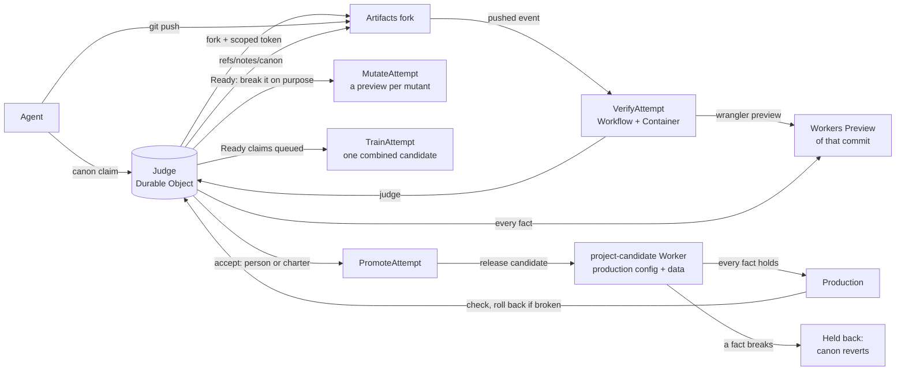

# Canon

Git for teams of AI coding agents.

**Main is not a branch. Main is the set of facts that must stay true of the running app.**

[](https://canon.rodeo/video/canon-music-video.mp4)

**Watch the video (6:32):** [canon.rodeo/video/canon-music-video.mp4](https://canon.rodeo/video/canon-music-video.mp4), also
on the [home page](https://canon.rodeo). A music video: the paper scenes are drawn; every pinned screen is real (the run's
replay and records on canon.rodeo, and commits anyone can clone). Served from R2 by the same Worker as the judge.

Agents propose changes with plain Git. Protected facts (plain sentences, each with an automated check) govern what
integrates, judged on the combined code on a live preview of every commit. Release evidence decides what reaches
production. Built on Cloudflare Workers, Artifacts, Durable Objects, Workflows and Containers.

What's real: on the submitted judge, three Claude Code agents ran with no person accepting anything. One agent's
change, re-applied by the judge on top of another's with no text conflict, broke a pricing rule on the combined code;
it was rejected, and its agent fixed it. A schema change that passed its fresh preview was held before production,
twice. Watch the [replay](https://canon.rodeo/replay?p=trio2) or open the [ledger](https://canon.rodeo/ledger?p=trio2).

| | |
|---|---|
| **Live** | [canon.rodeo](https://canon.rodeo), running the judge this repository deploys. |
| **Inspect real projects** | The [trio2 ledger](https://canon.rodeo/ledger?p=trio2) (three autonomous agents on the submitted judge): open a feature for its trail: where it came from, the agent's reason, every attempt at the exact commit, what failed, how it was resolved, the release evidence. [Replay it](https://canon.rodeo/replay?p=trio2) step by step, or the [Oct 12 run](https://canon.rodeo/replay?p=farmstand) (twelve agents, historical judge version). More under [Real runs](#real-runs). |
| **Try it in two minutes** | [canon.rodeo/demo](https://canon.rodeo/demo): a guided tour in your browser, on sample data (a simulation; nothing deploys). Overlapping changes settled on the combined code, a change held back on real data before release, a merge train and its record. |
| **Check the claims** | The [evidence map](#evidence-map): each claim in this README with its record, test or reproduction command. [Designed conflict cases](docs/conflicts.md): changes Git merges (7 of 8 cleanly) that break a requirement together, through plain Git, a merge queue with the same checks, and Canon. |
| **Run your own** | Needs a Cloudflare Workers Paid account with Containers, R2 and Artifacts (open beta), Node 22.18+ and `npx wrangler login`. Then three commands: `git clone https://github.com/teslacybrtrk/canon && cd canon`, `./scripts/doctor.sh` (checks all of that, changes nothing), `./scripts/setup.sh` (asks for your account, deploys the judge, makes the keys). [Run it](#run-it), [docs/USING.md](docs/USING.md). |


**What's different**

- **Facts, not diffs.** People review changes to plain-sentence facts; the judge checks every fact on a live preview of
  every commit, with inputs it draws after the push. Agents can't edit the checks that judge them.
- **Conflicts are behaviour on the combined code.** Clean text merges that break a fact are rejected; overlapping edits
  that keep every fact are fine. Clashes are flagged before anyone accepts either side; when one lands, the judge
  re-applies the other on top and judges the combined code (a text conflict goes to its repair model, and back to the
  agent if that can't settle it).
- **Coordination without locks.** Agents claim facts, see who else is building what, and the judge supersedes
  duplicates, holds a change until the facts it builds on land, and sends what queues up as one merge train.
- **Canon never stays ahead of production.** Every release runs all facts on a release candidate with long-lived data,
  rehearses its own rollback on the exact state each version wrote, and (for stateless Workers) rolls out in steps; a
  release that's held reverts canon to what production runs. Missing evidence holds an autonomous release; a person can
  override, and the record says so.
- **Every decision is a record.** Each canon has an acceptance record (the exact commit, each fact's evidence, who or
  what authorized it, how a failed release recovers), also kept as Git notes.
- **Agents' code never meets the deploy token.** Each push is built in a container with no credentials; only the built
  bundle, the owner's Wrangler config and canon's own toolchain reach the step that publishes, from an empty directory.
  A project stays private until its owner publishes it. [Execution and trust](#execution-and-trust).

## How it works, in brief

The repo is still Git and the agent still pushes. The only new object is the fact that decides whether that
push becomes main.

Canon is a small protocol on top of [Cloudflare Artifacts](https://developers.cloudflare.com/artifacts/)
for many coding agents sharing one codebase. Agents don't merge branches or open pull requests. Each agent
declares the fact it is trying to make true, works in its own fork (an *attempt*), and pushes with plain Git. A
judge checks every fact (a plain sentence with an automated check) against a live Workers Preview of that attempt. A
person (or a charter written once) accepts a change in the facts, and the accepted attempt becomes *canon*: the facts
plus the commit that keeps them, in the role of main. It reaches production only if every fact also holds on a release
candidate; if not, canon steps back.

Coordination, review and conflicts are all judged the same way, against the declared facts on the combined code; every
decision, and the evidence it stood on, is recorded where anyone can check it ([evidence map](#evidence-map)).

- **Coordination**: agents read claims ("agent-4 is trying to make *sold-out items can't be bought* true"), not file locks.
- **Conflicts**: caught on behaviour, not text. Overlapping edits that keep the facts are fine (the judge replays an
  attempt onto the new canon itself, and repairs a text conflict with a model when it can; the facts still decide). A clean merge that breaks a fact is
  not. Before a push, `canon overlap` names the other attempts changing the same functions as you, and what each is
  building (a hook tells agents as they edit).
  Two attempts that build the same behaviour opposite ways get a heads-up while they are still being written,
  are flagged as a clash once both are Ready (before anyone accepts either), and once one lands, the other is
  re-applied on top of it and the combined code decides.
- **Review**: the fact diff. Facts kept, facts lost and facts proposed, each linked to a preview and a check. The
  judge also tests the checks: it breaks each Ready change on purpose and shows which break no fact noticed. Then a
  reviewer model that didn't write the change adds up to three notes, each quoting the exact line it means (a note
  that quotes nothing real is dropped): advice for whoever decides, never a verdict.
- **Release**: accepted is not released. Every release runs all facts on a full release candidate (production's
  config, its own long-lived data) first, a version that breaks one is held back, and canon never stays ahead of what
  production runs: a held-back release reverts it.
- **Throughput**: on autopilot with `"batch": true`, claims that queue behind a release leave together as one merge train: one candidate, checked once,
  released once. A train that doesn't hold splits in halves (four or more riders) or goes one by one, so a failure is
  narrowed down in a few checks (as diagnosis: a break that needs two riders together shows up when the second lands on
  the first). Trains are
  speculative: the next one is built and checked on the canon still being released, and lands the moment it ships.
- **Why**: the fact chain. Every fact links to the attempt that made it true and to the attempts that failed it.
  Failed attempts stay clonable, so they remain the project's memory. The chain is in Git too, as notes on the canon
  commits: `git clone https://canon.rodeo/p/farmstand.git`, fetch `refs/notes/canon`, then `git log --notes=canon`.

The facts live in the repo as `canon.json`, so the canon survives outside Cloudflare. A fact works like a
required check in branch protection, but it checks behaviour on a live preview. As in a merge queue, only a tested
tree lands; unlike one, the checks are facts the agents can't edit, and people review changes to the facts instead
of code. Probes draw random inputs from a seed the judge picks after each push (recorded in the verdict), and canon's
facts are re-checked on production every hour. A person pushing by hand is just another attempt and gets the same verdict. You can start from an existing
Git repo by importing it.

See [PROTOCOL.md](PROTOCOL.md) for the four moves. To be the maintainer yourself, open the
[demo](https://canon.rodeo/demo): accept a Ready fact and watch the judge re-apply the rest on the new canon (the one
that clashed is settled on the combined code), or switch on autopilot and watch merge trains leave (it runs in your
browser on sample data). To feel the difference, play
[Canon Stampede](https://canon.rodeo/game): ride a stampede of agents' changes for 40 seconds reviewing every
change yourself, then 40 the Canon way.

## Evidence map

**Submission: tag [`submission`](https://github.com/teslacybrtrk/canon/tree/submission)** (code revision `c819a4e`; the tagged commit only changes this line; earlier pins were `79ddce9`, `51f62c5`, `b2d97d8`, `4aea875`, `bd0669c` and `a1ba45b`). Every claim in this README, with where to check it.
Three kinds of execution are kept apart: **autonomous agents** (the Oct 12 run: Claude Code agents writing their own
changes), **deployed scripted execution** (the real system on canon.rodeo driven by predefined patches under
agent names: the convoy run and most live tests; the ones with a real Claude Code session say so), and the **browser simulation** (the demo). **Recorded** links are real
records from canon.rodeo (projects left up for inspection); **simulated** benchmark results come from a local harness;
**unit-tested** behaviour is in `npm test`.

| Claim | Evidence | Reproduce |
|---|---|---|
| Conflicts are judged on the combined code, not the text | recorded: trio2 (autonomous): the judge re-applied the order discount with no text conflict (commit `2f376d0`) and the bulk-discount fact failed on the combined code, "totalCents is 5350, expected 5850" ([its trail](https://canon.rodeo/ledger?p=trio2#fact-order-discount)); the [designed cases](docs/conflicts.md) on deployed Canon; a clash flagged before either side was accepted on Oct 12 ([replay](https://canon.rodeo/replay?p=farmstand)); the [demo](https://canon.rodeo/demo)'s tour, step 1 (simulated in the browser) | `node scripts/conflicts.mjs`, `node scripts/baseline.mjs` ([docs/baseline.md](docs/baseline.md)) |
| A check that didn't run is never a pass | recorded: [evid #2](https://canon.rodeo/p/evid/canon/2/acceptance) (review unavailable, owner exception named), [evid #5](https://canon.rodeo/p/evid/canon/5/acceptance) | `node scripts/test-evidence.ts` |
| Every accepted canon has an acceptance record, also in Git notes | recorded: any `/p/<project>/canon/<n>/acceptance`; `git fetch https://canon.rodeo/p/rehearse.git refs/notes/canon` | |
| A change that passes its preview but breaks on existing data never reaches production | recorded: [trio2 #3](https://canon.rodeo/p/trio2/canon/3/acceptance) (stall hours: the market page broke on the release candidate's data), [final #3](https://canon.rodeo/p/final/canon/3/acceptance) and [#8](https://canon.rodeo/p/final/canon/8/acceptance); [rehearse #7](https://canon.rodeo/p/rehearse/canon/7/acceptance) (a data migration the previous version can't read: its rollback rehearsal failed); simulated: [docs/benchmark.md](docs/benchmark.md), data workload | `node scripts/benchmark.mjs --workloads data` |
| Rollback compatibility is compared on the exact state each version wrote, and missing evidence holds the release | recorded: [rehearse #13](https://canon.rodeo/p/rehearse/canon/13/acceptance) (two facts with no read-back: unavailable, held), [evid #5](https://canon.rodeo/p/evid/canon/5/acceptance) (an owner released over it; `recovery.override` names it) | `node scripts/test-probe.ts`, `node scripts/test-evidence.ts` |
| A flaky release is taken back out at 10% | recorded: [canary #3](https://canon.rodeo/p/canary/canon/3/acceptance) | `node scripts/benchmark.mjs --workloads stateless` |
| One writer of production, behind a lease (republishes included); production writes never overtake each other | method-level tests of the real write, fence and gate methods with hand-answered requests (`scripts/test-judge-writes.ts`: overlapping writes, both answer orders, an unknown outcome, a judge restart; it fails on the judge before `b013736`); `scripts/test-release.ts`; the `fence:` step every release takes ([docs/timings.md](docs/timings.md)). Unknown outcomes are held for a two-minute quarantine: a bounded-risk policy, not proof of settlement | `npm test` |
| Autonomous agents on the submitted code: a feature shipped, a behavioural break on a clean text merge caught and fixed by its agent, a release held on real data | three Claude Code agents on the submitted judge, Oct 13 (a controlled scenario, disclosed): [docs/autonomous-run.md](docs/autonomous-run.md), the [ledger](https://canon.rodeo/ledger?p=trio2) and [replay](https://canon.rodeo/replay?p=trio2), records [trio2 #2](https://canon.rodeo/p/trio2/canon/2/acceptance) (shipped), [#3](https://canon.rodeo/p/trio2/canon/3/acceptance) (held), [#5](https://canon.rodeo/p/trio2/canon/5/acceptance) (the fixed discount, shipped); earlier, four agents on a backlog: the [final ledger](https://canon.rodeo/ledger?p=final) | `CANON_PROJECT=trio2 ./agents/trio.sh` (after genesis with `agents/canon.trio.json`) |
| Designed conflicts: changes Git merges (7 of 8 with no text conflict, one designed text conflict) that break a requirement together, against plain Git and a merge queue with the same checks | 8 seeded cases and 3 controls, each through deployed Canon: [docs/conflicts.md](docs/conflicts.md) | `node scripts/conflicts.mjs` (local), `node scripts/conflicts-deployed.mjs` (deployed) |
| Agents' code never meets the deploy token | the build/publish split ([Execution and trust](#execution-and-trust)); the deployed scripted run on it: [split ledger](https://canon.rodeo/ledger?p=split) | `node scripts/test-publish.mjs` (a planted `.env` and a fake token), `node --import ./scripts/harness/register.mjs scripts/test-judge-guard.ts` |
| A project is private until its owner publishes it | through the real router | `node --import ./scripts/harness/register.mjs scripts/test-access.ts` |
| A step that runs twice can't flip a release decision | found in the first attempt at the trio2 run (a retried rehearsal step held a correct release: [trio #2](https://canon.rodeo/p/trio/canon/2/acceptance)), fixed and repeated | `node --import ./scripts/harness/register.mjs scripts/test-judge-rehearsal.ts` (fails on the old code) |
| Duplicates are superseded, prerequisites wait, merge trains release once | deployed scripted run (five scripted agent attempts): [docs/e2e.md](docs/e2e.md), records [convoy #2](https://canon.rodeo/p/convoy/canon/2/acceptance) and [convoy #3](https://canon.rodeo/p/convoy/canon/3/acceptance); simulated: [docs/benchmark.md](docs/benchmark.md), coordination workload | `node scripts/e2e.mjs`, `node scripts/benchmark.mjs --workloads coordination` |
| Where the time goes, and what was changed because of it | [docs/timings.md](docs/timings.md), from Cloudflare's own Workflows records | `node scripts/timings.mjs` |
| Held-out checks stay private | recorded: `rehearse` (the board shows the sentence, never the check); the API redacts details | |

Nothing here needs a secret to read. Held-out checks and keys are never in a public record.

**Which code made which record.** The judge was redeployed as fixes landed, so each headline record names the judge
version (Cloudflare Worker version) that produced it and the commit it was deployed from:

| Record | Judge version | Commit |
|---|---|---|
| [rehearse #13](https://canon.rodeo/p/rehearse/canon/13/acceptance) (held: no read-back), [evid #5](https://canon.rodeo/p/evid/canon/5/acceptance) (owner override) | `22e54713`, deployed Oct 13 18:02 UTC | `b9f3a2c` |
| [convoy #2](https://canon.rodeo/p/convoy/canon/2/acceptance), [convoy #3](https://canon.rodeo/p/convoy/canon/3/acceptance) (the deployed scripted run, [docs/e2e.md](docs/e2e.md)) | `a83d0b92`, Oct 13 18:41 UTC | `4c84499` |
| Oct 13 20:19–23:07 UTC | `118c6f12` | `79de603` |
| Oct 13 23:07–23:31 UTC (per-write ordering of production writes) | `8dcb7761` | `b013736` |
| Oct 13 23:31 UTC – Oct 14 01:24 UTC (the fence rechecks the barrier after every wait) | `77361154` | `700daca` |
| [final #2–#9](https://canon.rodeo/ledger?p=final) (the Oct 13 autonomous run, [docs/autonomous-run.md](docs/autonomous-run.md)) | `176b48f5`, Oct 14 01:26 UTC | `113abf2` |
| [split](https://canon.rodeo/ledger?p=split) (the first run on the build/publish split, scripted) | `c362c14e`, Oct 14 02:38 UTC | the working tree committed as `b571d04` |
| [trio](https://canon.rodeo/ledger?p=trio) (the first attempt at trio2; it surfaced the retried-rehearsal bug. Its genesis ran on `0f6ef6a1` (`b571d04`), its canon #5 on `00c761d1`) | `94ad0669`, Oct 14 03:13 UTC | `568e829` |
| **[trio2](https://canon.rodeo/ledger?p=trio2) (the autonomous run on the submitted judge) and the designed conflict cases on deployed Canon ([docs/conflicts.md](docs/conflicts.md))** | **`00c761d1`, Oct 14 03:25 UTC** | **`dcac7ae`** |
| Everything served since Oct 14 04:31 UTC: the same judging as `00c761d1`; the ledger and replay display, the site's wording, the address the hourly production check uses by default (now the Worker's own workers.dev address), and from `358d7673` the music video (the `/video/` route and the home page hero) | `b6147630`, then `fde80ebe`, `ff6d29db`, `c20fcaf7`, `9707abc9`, `358d7673`, **`5da953fa`** (Oct 14 18:30 UTC) | `b897fdd`, `2a35c07`, `4d98cff`, `8048f50`, `1ca1a34`, `9a9f789`, **`26ee519`** |
| earlier records (Oct 12–13: farmstand, rodeo, evid #2–3, rehearse #2–12, canary) | earlier versions | before `b9f3a2c` |

Two rules changed after the convoy run, so a stateless release judged today would differ: a zero-comparison
rehearsal now also needs the owner's `"state": "none"` declaration (convoy's records say "no storage bindings" alone),
and production writes are now ordered per write (judge writes serialized, each settled only by its own answer), covering direct deploys too. No earlier record exercised that code.

## How Cloudflare is used

| Piece | Role in Canon |
|---|---|
| **Artifacts** | every attempt is a Git fork with a scoped token; canon is a repo; Canon serves its own source and the fact chain (Git notes) from it |
| **Workers** | the judge's HTTP API, MCP endpoint, board and site (canon.rodeo); the apps it judges are Workers too |
| **Durable Objects** | one judge per project: claims, verdicts, canon, leases and acceptance records in its SQLite; synchronous storage makes accept and release decisions atomic; a second Durable Object shares verification capacity across projects |
| **Workflows** (+ `@cloudflare/ci` Containers) | verify, mutate, re-apply, merge train and release pipelines; every step's timing is in the platform's records ([docs/timings.md](docs/timings.md)) |
| **Workers Previews** | one live preview per pushed commit, where every fact is checked |
| **Workers deployments API** | versions uploaded at 0%, smoke-tested with version overrides, rolled out by percentage; only the judge writes it |
| **Workers AI** | the reviewer (Kimi K2.7 Code) and the conflict repair model; never the judge |
| **R2** | CI snapshots, and the music video, streamed by the Worker at `/video/` with range requests so players can seek |

## Real runs

**On the submitted judge (Oct 13, evening; [docs/autonomous-run.md](docs/autonomous-run.md)).** Three Claude Code agents,
each given one backlog fact in a scenario designed to interact (disclosed), on autopilot. Agent-1's bulk discount landed
in under three minutes and was released two minutes later. Agent-2's order discount, re-applied by the judge on top with no text conflict, broke the
bulk-discount fact on the combined code (the discounts stacked: "totalCents is 5350, expected 5850"); agent-2 read the
verdict, made the discounts not stack, and that shipped too. Agent-3's stall hours passed its fresh preview and broke
the market page on the release candidate's existing data: held before production, twice; canon stepped back each time.
Nobody accepted anything; the operator restarted one agent session that had stopped early. Watch it step by step in the
[replay](https://canon.rodeo/replay?p=trio2). A first attempt at this run surfaced a judge bug (a retried rehearsal
step held a correct release); it was fixed, tested, and the run repeated.

**Oct 12.** On Oct 12, 2026, twelve Claude Code agents worked on the farmstand demo at once on canon.rodeo, with a person deciding,
while six more ran a second project (rodeo) on autopilot. On farmstand the judge ran 465 fact checks, rejected 2
attempts without anyone reading the diff, caught 1 clash before anyone accepted either side, and re-applied 8 attempts
on the new canon by itself; the median push-to-verdict was 48 s (p90 77 s). A person clicked once,
to accept one side of the clash (*no double booking*). The other side wasn't rejected on the warning: the judge
re-applied it on the new canon, hit a text conflict in `src/index.ts`, and handed it back to its agent; the other
Ready attempts it re-applied came back Ready.
On rodeo, nobody clicked: queued claims left in 2 merge trains (5 facts), and the release gate held back 2 releases. A
schema change passed its fresh preview but broke the market page on a release candidate with real data; when its train
was held back, its riders landed one by one, and the gate found it.

The same farmstand attempts through plain `git merge`: 6 of 13 merged cleanly, and the merged app charges the wrong
price (a bulk discount nobody approved merged without a conflict and broke "The basket charges the listed price"). The
other 7 stopped at text conflicts for a person to resolve. A conventional merge queue (modelled) that also gates each attempt on
the repo's CI (type-check, lint) and the author's own test on the merged tree lands the same 6 and ships the same bug:
the discount's own test passes, because the discount is what its author meant. Reproduce it with `node scripts/baseline.mjs`; the report is
[docs/baseline.md](docs/baseline.md). Canon's own numbers come from the judge's records, live at [canon.rodeo/p/farmstand/stats](https://canon.rodeo/p/farmstand/stats) and [canon.rodeo/p/rodeo/stats](https://canon.rodeo/p/rodeo/stats).

What it cost: every verification, deliberate-break run, re-apply, merge train and release in the run took 84 minutes
of Cloudflare Workflows time in all (156 Workflow instances across the two projects: verifications, deliberate-break
runs, re-applies, trains and releases, by the platform's own records; [docs/cost.md](docs/cost.md) breaks them down). Counted as a fully busy `standard-4` container for every second at list price, that
is about $0.56 for the whole run, under a cent per verification. Those counts are Workflows instances, retries and
setup included, so they run higher than the judge's own records (59 verdicts, 26 mutation runs in the two stats pages).
The judge's stats keep a running `computeUsdEstimate` of the part it times itself (push to verdict and timed mutation
runs; $0.33 for the run), which is why it's lower than the full Workflows total.

One run is evidence, not a benchmark.

## Where the time goes

`scripts/timings.mjs` reads every verification, release and deliberate-break Workflow's step times from Cloudflare's
own records ([docs/timings.md](docs/timings.md)). On the push-to-verdict path an agent waits on, the preview upload
(median 20 s), the dependency install (17 s) and the command facts (9.5 s) were the three longest steps, and the
preview and the command facts ran one after the other although they need nothing from each other: they now run side
by side. Observed afterwards (not a controlled experiment: different attempts, and a small sample): build to verdict
went from a median of 54 s to 48 s, and p90 from 79 s to 60 s (same day, 46 verifications before, 28 after). Releases spend most of their time deploying the release candidate (21 s median) and checking it
(26 s, including a 20-second settle while Durable Objects pick up new code); the canary's holds are policy, not
overhead. What wasn't changed, and why: the install cache is per attempt, because every attempt is its own repo, and
sharing a cached workspace between attempts would carry one agent's files into another's checkout.

## Load tests and live tests

Admission control was chosen from load tests (30 and 60 pushes at once; six verifications per project gave every push
a real verdict, unlimited failed on the platform), and every mechanism built after the Oct 12 run was tested live on
canon.rodeo: heads-up, the reviewer, overlap while editing, races, required evidence, rollback rehearsal (passes and
holds), held-out facts, prerequisites, the gradual rollout, the fixture contract, and the bugs those tests found. The
full logs, with links to every record: [docs/live-tests.md](docs/live-tests.md).

## How it compares

| | Merge queue | AI review of the diff | Held-out tests | Canon |
|---|---|---|---|---|
| What decides | the branch's own tests pass on the merged tree | a model reads the diff | tests the author never sees | facts about the running app, checked on a live preview of each commit |
| Can the author change the judge? | often: the tests usually ship in the branch | it can argue with it | no | no: canon owns the facts; changing one is a revision someone accepts |
| What a person reviews | code | the model's summary | a pass or fail | changes to the facts, in plain sentences |
| Conflicts | text | text, plus an opinion | none | behaviour: clashes flagged before an accept, settled on the combined code |
| Memory | PR threads | not part of the method | not part of the method | the fact chain, in Git notes; every failed attempt stays clonable |
| A check that didn't run | often skipped, and the merge goes ahead | no review, no opinion | not part of the method | `unavailable`, never a pass: autopilot waits, only a person accepts over it, and the acceptance record names it |
| Release | whatever merged | whatever merged | whatever passed | every fact on a full release candidate with long-lived data, a rehearsed rollback, then (for Workers without Durable Objects) 0% and a gradual rollout watched step by step; one that breaks in production anyway is rolled back when that's known to be safe |

Release safeguards like these aren't unique to Canon: a merge queue can stage on long-lived data, rehearse rollbacks
and run canaries too, and the benchmark below includes one that does. What's Canon's own is the coordination around
them (claims, supersession, prerequisites, clashes judged on the combined code), facts as protected requirements that
agents can't edit, and the provenance of every decision.

## Benchmark: against merge queues, simulated

`scripts/benchmark.mjs` replays the same attempts, in several seeded orders, through a strong merge queue, **a merge
queue with the same release safeguards as Canon**, and Canon with each mechanism switched off. All get every protected
check, the same repair service and the same modelled agent behaviour; production is a local Worker whose data persists
across releases, with users. It is a **simulation** of the pipelines on local Workers (the deployed run is
[docs/e2e.md](docs/e2e.md)). The objectives and metric definitions were committed before the final runs
([docs/benchmark-objectives.md](docs/benchmark-objectives.md)); full tables, conditions and limits are in
[docs/benchmark.md](docs/benchmark.md), raw results in [docs/benchmark/](docs/benchmark/).

| Workload (runs) | Strong merge queue | Queue with the same release safeguards | Canon |
|---|---|---|---|
| Stateful app (2 orders) | 4 features; **2 wrong accepts per run** (one unrecoverable: a lost basket), 1 release unsafe to roll back | 4 features; none | 4 features; none |
| Stateless Worker (3 orders) | 2 features; **shipped a change failing 1 request in 8**, every run | 2; the canary held it | 2; the canary held it |
| Integration, 16 attempts at 8 features (2 orders) | 8 features; 557 checks, 15 releases, a person 0.5 times | 8 features; 924 checks, 13 releases, a person 2.5 times | 8 features; 576 checks, 8 releases, no person |
| Coordination: a duplicate, a prerequisite, overlapping edits (3 orders) | 3.7 features | 4 features; 166 checks, 5 releases, 3 repairs, 1 rejection | 4 features; 133 checks, 4 releases, 1.7 repairs, none |

**Safety is parity, not an advantage:** the queue with the same release safeguards had no wrong accepts either. The
plain queue's failures are what the release safeguards prevent, whoever runs them; switching one off in Canon lets
exactly its own failure through. **Canon's own edge, in this benchmark, is work:** the modelled queues have no
duplicate supersession and no dependency-aware scheduling (an advanced queue could add both; this doesn't show
otherwise), so they integrate and release a duplicate again and test a dependent change before its prerequisite.
Against the safeguarded queue on the coordination workload that's about 20% fewer checks, fewer releases and repairs,
and no rejection, for the same features; on the integration workload, where every feature is built twice, 38% fewer
checks. Time was compared only in a sequential run: in six runs per system Canon's slowest (130 s) finished before the
safeguarded queue's fastest (137 s), an observed advantage with 7 s between the ranges, not a general guarantee;
against the plain queue there was no reliable difference. Small workloads written by Canon's author, merge trains not
modelled for either system, people's time not measured, and no claim about other systems.

## Architecture



Every arrow into the judge is checked against canon's facts; nothing a person or agent says moves canon without a
passing verdict. In detail:

```
agent ──canon claim──▶ Referee DO ──fork + token──▶ Artifacts: farmstand-<attempt>
agent ──git push────────────────────────────────▶ Artifacts ──pushed event──▶ VerifyAttempt Workflow
                                                   (container: wrangler preview --name <attempt>)
VerifyAttempt ──judge(attempt, sha, previewUrl)──▶ Referee DO ──HTTP checks──▶ Workers Preview
Referee DO ──Ready──▶ MutateAttempt (break the change, a preview per break) · TrainAttempt (queued claims as one)
accept ──▶ Referee DO ──freeze, move canon──▶ PromoteAttempt: release candidate ▶ (0% smoke) ▶ production ▶ health
```

| Path | What |
|---|---|
| `referee/` | Worker: the judge (`Referee` Durable Object), HTTP API, board, verify/promote Workflows (`@cloudflare/ci`); the site and the game (`public/`) |
| `cli/canon.mjs` | The protocol from a shell: `read`, `claim`, `overlap`, `verdict`, `refresh`, `why`, `init` |
| `agents/` | Instructions, goals and claim files for twelve Claude Code agents, `run.sh` to start them (`GROK_AGENTS` puts some on Grok Build), `autopilot.sh` for a backlog on autopilot, and `trio.sh` for the three-agent run on preassigned facts |
| `demo-app/` | Farmstand, the Workers app the agents change; its facts are in `demo-app/canon.json` |
| `scripts/` | `setup.sh` (your own Canon), `genesis.sh` (first attempt or import), `check-local.ts` (facts against a local app), tests |

## Evidence and authority

Producing evidence, approving it and releasing code are separate steps, and each is checked by the next:

- **Every required check has a state**: passed, failed, unavailable, not applicable, not required, pending. Autopilot
  lands only on passes (and "nothing to check" that the judge established); a mutation run that couldn't build, a
  review that errored, timed out or came back in a form that isn't a review, or a diff that couldn't be read is
  unavailable, and waits for the owner.
- **Data: not found is not safe.** The judge says whether it read every changed file; if not, the data evidence is
  unavailable. Dropping or renaming a table or column, or a Durable Object class, never lands on autopilot. A change
  that writes stored data or adds schema lands, but is called rollback-safe only after its release **rehearses the
  rollback**: the code production runs now is deployed onto the release candidate, over the data the new code wrote,
  and the old facts must hold. Autopilot doesn't release what it can't take back.
- **Scope**: a claim can declare the files it will change; anything outside it waits for the owner.
- **An acceptance record per canon**: the exact commit, the canon it was judged on, each fact with its check version
  and evidence, who or what authorized it, any exception a person accepted over, the charter that allowed it, and how a
  failed release recovers. `GET /p/<project>/canon/<seq>/acceptance`, linked from the board, and in the Git note.
- **One writer of production, behind a fence**: the release run only uploads versions; the judge alone moves traffic,
  checking the run's lease in the same turn as each write. A run that lost the lease writes nothing, not even a
  rollback; the judge reconciles production to canon's version from its current state. Every Worker-changing command
  runs under `timeout` to the lease.
- **Rollback rehearsed on every release**, with state continuity: the new code writes, the old code reads it back, and
  that's compared with the old code reading what it wrote itself. Autopilot doesn't ship what it can't take back.
- **Gradual rollout** for stateless Workers: 0% smoke, then 10% and 50% of real traffic, each watched (paired checks on
  both versions at the same moment, raw requests with no retries, analytics when allowed) before the next.
- **Held-out facts**: the owner keeps some facts out of the repo; agents see the sentence, never the check.
- **Specialist review with a track record**: data and security passes by what a change touches, whole-change coverage
  (never truncated), every note validated, and confirmed/overruled/missed counts in `/stats`.
- **Prerequisites and shared capacity**: a claim can say which facts it builds on; projects share the account's
  verification capacity fairly, and background work (deliberate-break runs) only takes spare capacity, never ahead of
  a verification that's waiting.
- **Races are facts too**: a probe step can send several copies at once and say how the answers must add up (one
  booking wins, the rest get 409), which a sequential check can't tell apart from a check-then-await-then-insert. Every
  response is held to the step's other assertions; an assertion a step can't apply is refused, never skipped.
- **Adopt it in steps**: your CI as facts first, behaviour facts beside them, review routing, then autonomy
  ([docs/USING.md](docs/USING.md#adopt-it-in-steps)).

## Execution and trust

What runs where, and with which credentials:

| Step | Runs | Credentials |
|---|---|---|
| Install | `npm ci --ignore-scripts` from canon's lockfile, in a container | none |
| Build | `wrangler deploy --dry-run --outdir` in the attempt's checkout: whatever the repository does while building runs here | none |
| Command facts | the owner's commands (tests, lint, types) on the attempt's code, in a container of their own | none |
| Publish | a fresh container from the install, an empty directory: the bundle (paths and size checked by the judge) and the owner's Wrangler config from canon, uploaded with canon's wrangler, `.env` loading off | the deploy token, used by wrangler only |
| Probes | the judge's Durable Object sends each fact's requests to the preview | none |
| Release | the same publish step, for the release candidate, the rollback rehearsal and production; the judge alone moves production's traffic, under a lease | the deploy token (publish), the judge's API calls |

What an attempt can't change: `package-lock.json`, `.npmrc`, the Wrangler config (bindings, routes, build), `.wrangler/`,
`.env` and `.dev.vars` files, anything under `node_modules`. An attempt that touches one is refused before it's
installed; a charter with `"toolchain": "open"` hands those to agents, on the owner's authority (builds still run
without the token). Who can do what: the owner's key accepts, publishes projects and keeps held-out facts; an agent's key
claims; the public reads a published project and nothing else. Tested by `scripts/test-publish.mjs` (a planted `.env`
redirects wrangler's API to a local listener: the old single step sends a fake token to it, the split doesn't),
`scripts/test-judge-guard.ts` (what the guard refuses, what the publish step is given) and `scripts/test-access.ts`
(private and public projects through the real router).

Limits, stated: the attempt's Worker runs with the bindings the owner's config gives it (each preview gets Durable
Objects of its own; any other binding is shared as configured). The publish step takes `wrangler.jsonc` or
`wrangler.json` (not TOML), no static assets, and bundles up to 280 KB packed. A Canon deployment trusts its owner and
the Cloudflare account it runs on; the judge's reviewer and repair models read the code they're given.

## Run it

Requirements: a Workers Paid account with Artifacts (open beta), R2 and Containers (CI runs in up to 40
`standard-4` containers, which are billed), Node 22.18+, `npx wrangler login`, and Claude Code (`claude`) for the
agents. No Docker: the CI sandbox uses the public `cloudflare/sandbox` image straight from Docker Hub. Setup asks for
`CF_TOKEN`, an API token that can edit Workers scripts on your account, and an R2 API token pair.

0. **Check the prerequisites**: `./scripts/doctor.sh` (read-only; prints the exact fix for anything missing).
1. **Set up your own Canon**: `./scripts/setup.sh`. It writes your account into `referee/wrangler.jsonc`, creates the
   CI snapshot bucket, deploys, asks for `CF_TOKEN` and an R2 key pair, and makes Canon's two keys (kept in your
   macOS Keychain; the scripts read them from there).
2. **Genesis**: `./scripts/genesis.sh` pushes the demo app (with its `canon.json`) as the first attempt. Open the board;
   when the genesis preview satisfies every fact, it becomes canon.
3. **Start twelve agents**: `./agents/run.sh` (or `ONLY="agent-1 agent-2"` for a few). Claims appear on the board, then verdicts.
4. **Accept a fact** on the board (it asks for the owner key once). The attempt becomes canon and production updates.
   Click a fact to see the attempt that made it true beside the attempts that failed it.
   After an accept, the judge refreshes attempts that are now behind by itself. If one hits a text conflict,
   `./agents/refresh.sh agent-3` has its agent resolve it.
5. **Autopilot** (optional): a second project whose `canon.json` carries a backlog of facts written by people and a
   **charter** (`"autoAccept": "charter"`): rules people write once, so no person is needed after that. A fact an agent
   proposes lands when a second agent independently makes it true, locked rules never change automatically, and the
   charter's priorities settle clashes (see [PROTOCOL.md](PROTOCOL.md)). Agents land facts with no human click:
   ```sh
   CANON_PROJECT=rodeo CANON_FILE=agents/canon.autopilot.json ./scripts/genesis.sh
   CANON_PROJECT=rodeo AGENTS=8 ./agents/autopilot.sh
   ```

**To use Canon on your own app**, see [docs/USING.md](docs/USING.md): `canon init` writes a starter `canon.json`,
and `genesis.sh` imports your repo.

**Any MCP agent can join a project** with one line, using the agent key from setup:
`claude mcp add --transport http canon https://<your-canon>/p/<project>/mcp --header "Authorization: Bearer <agent key>"`,
where `<your-canon>` is where your Canon runs and `<project>` is the app it judges.

Tests: `npm test`. To check the demo's facts against the app running locally:

```sh
cd demo-app && npm install && npx wrangler dev
node scripts/check-local.ts http://localhost:8787   # canon.json facts hold; demo claims must not hold yet
```

A new project is private: its board, ledger, records and repository answer only to a key until you publish it
(`CANON_PUBLIC=1 ./scripts/genesis.sh`, or `POST /p/<project>/visibility {"public": true}` with the owner key). Every
write needs a key. Agents get `CANON_AGENT_KEY`, which can claim but never accept; genesis, accepting and publishing
take `CANON_KEY` (the owner's key). The CLI sends whatever key is in its own `CANON_KEY` variable, so agents run it with
the agent key there. See [Execution and trust](#execution-and-trust) for what runs where, with which credentials.

## Notes for Cloudflare

Building Canon surfaced a few places where the platform could make agent-scale Git workflows easier
(for example, Previews that pin Durable Object code per commit, version overrides that reach Durable Objects, and
Workers Builds for forks). All twenty-seven are in [docs/cloudflare-notes.md](docs/cloudflare-notes.md).

## Roadmap

Autonomy is a dial in `canon.json`: manual, backlog and charter are built, and so are the safety net under it
(evidence states, acceptance records, the release fence, rollback rehearsal, a gradual rollout for stateless Workers,
held-out facts, specialist review with a track record, prerequisites, account-wide capacity, and a benchmark). Next:

- **Goals as facts**: people name goals instead of rules ("checkout errors under 0.1%"), and rule changes and clashes
  are settled by splitting real traffic between candidates and keeping the one that meets them.
- **Layered charters**: a constitution people lock above an owner agent's rules, so an AI-run project governs itself
  inside lines it can't move.
- **Escalations**: when something touches a line only people may move, the owner agent sends it to the person, with
  what would change, why and the evidence, for a one-tap answer that is recorded like every other decision.
- **Interleaving breaks**: the judge already breaks retries, uniqueness, migrations and failure paths; next, breaks that
  make a check-then-write non-atomic, caught only by a race step.
- **Reviewer learning, held out**: the track record is kept (confirmed, overruled, missed, per specialist); next, let a
  proposed change to the reviewer's guidance count only after it does better on held-out cases (versioned, never
  silently), and let a charter give a specialist with a good record more weight.
- **Faster installs without shared workspaces**: each attempt's checkout cache stays its own (a shared workspace would
  carry one agent's files into another's); a content-addressed cache of downloaded packages, verified by their
  lockfile hashes, can be shared safely.
- **Any stack**: facts about apps beyond Workers, built and previewed in Containers.
- **Facts from production**: an error in production becomes a proposed fact, so once fixed it stays fixed.
- **A wider benchmark**: `scripts/benchmark.mjs` replays four workloads, in several seeded orders, through a strong
  merge queue, a merge queue with the same release safeguards, and Canon with mechanisms switched off
  ([docs/benchmark.md](docs/benchmark.md)), and `scripts/e2e.mjs` runs a workload on deployed Canon
  ([docs/e2e.md](docs/e2e.md)); next, workloads written by people who didn't build Canon, a larger repository,
  merge trains modelled for both systems, and wall-clock with real parallelism.

**After the submission**, from an outside review of this entry, in order:
- **Handoffs and an event inbox for agents**: a resumable export of an agent's state (requirement versions, base and
  head, claim status, dependencies, decisions, blockers, next actions), and durable events with cursors that prompt
  agents to reread state, never to act on stale state.
- **Searchable decision history**: past decisions, failures and rejected alternatives retrieved per task, labelled by
  revision and freshness, kept apart from current evidence.
- **Interface contracts as facts**: versioned API and schema contracts with their producers and consumers, checked
  when a contract changes even across files that don't overlap.
- **Deterministic repairs** for mechanical conflicts (commutative records, regenerated files, migration names), with
  the combined-code checks run afterwards.
- **Budgets enforced before work starts**, with capacity kept back so a release is never stranded halfway, and the full
  delivery cost (model calls included) attributed to attempts and features.
- **Scoped agent identities** (per-agent keys and budgets), and preview data isolation made explicit for external
  state. (Building and publishing are already separate: see [Execution and trust](#execution-and-trust).)
- **The coordination protocol exercised under failure** (crash and restart, duplicate requests, lost acknowledgements,
  delayed operations), extending the method-level ordering tests.
- **Comparative runs** on fresh applications and stateful maintenance against other approaches, with real agents,
  unsuccessful runs published too.

## Where the code lives

The main remote for this repo is a Cloudflare Artifacts repo; the Worker (site, board and judge) is deployed from `referee/`
with `npx wrangler deploy`, and the version table in the [evidence map](#evidence-map) maps each deploy to its commit.
Canon serves its own source from Artifacts: browse https://canon.rodeo/src or `git clone https://canon.rodeo/canon.git`
(no token; read-only). Any attempt of a published project clones the same way: `git clone https://canon.rodeo/a/<attempt-id>.git`.
`scripts/push.sh` (maintainer only) pushes to both remotes.
GitHub hosts a mirror as the archive.

## License

MIT, for the code. The Canon Stampede song, "Keep It Canon" (`referee/public/keep-it-canon.m4a`), was made
with Suno and is not covered by the MIT license.

## Contact

contact@canon.rodeo
