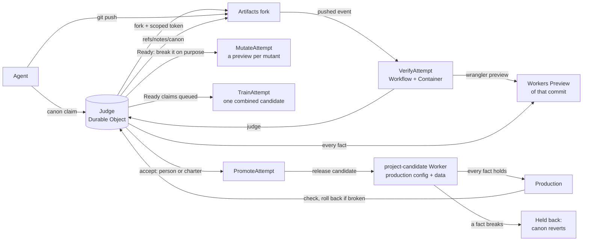

# Canon

**Main is not a branch. Main is the set of facts that must stay true of the running app.**

The repo is still Git and the agent still pushes. The only new object is the fact that decides whether that
push becomes main.

Canon is a small protocol on top of [Cloudflare Artifacts](https://developers.cloudflare.com/artifacts/)
for many coding agents sharing one codebase. Agents don't merge branches or open pull requests. Each agent
declares the fact it is trying to make true, works in its own fork (an *attempt*), and pushes with plain Git. A
judge checks every fact (a plain sentence with an automated check) against a live Workers Preview of that attempt. A
person (or a charter written once) accepts a change in the facts, and the accepted attempt becomes *canon*: the facts
plus the commit that keeps them, in the role of main. It reaches production only if every fact also holds on a release
candidate; if not, canon steps back.

- **Coordination**: agents read claims ("agent-4 is trying to make *sold-out items can't be bought* true"), not file locks.
- **Conflicts**: caught on behaviour, not text. Overlapping edits that keep the facts are fine (the judge replays an
  attempt onto the new canon itself; only a text conflict goes back to its agent). A clean merge that breaks a fact is
  not. Two attempts that build the same behaviour opposite ways get a heads-up while they are still being written,
  are flagged as a clash once both are Ready (before anyone accepts either), and once one lands, the other is
  re-applied on top of it and the combined code decides.
- **Review**: the fact diff. Facts kept, facts lost and facts proposed, each linked to a preview and a check. The
  judge also tests the checks: it breaks each Ready change on purpose and shows which break no fact noticed.
- **Release**: accepted is not released. Every release runs all facts on a full release candidate (production's
  config, its own long-lived data) first, a version that breaks one is held back, and canon always equals what
  production runs: a held-back release reverts it.
- **Throughput**: on autopilot with `"batch": true`, claims that queue behind a release leave together as one merge train: one candidate, checked once,
  released once. A train that doesn't hold lands its riders one by one, so the gate finds the culprit.
- **Why**: the fact chain. Every fact links to the attempt that made it true and to the attempts that failed it.
  Failed attempts stay clonable, so they remain the project's memory. The chain is in Git too, as notes on the canon
  commits: `git clone https://canon.rodeo/p/farmstand.git`, fetch `refs/notes/canon`, then `git log --notes=canon`.

The facts live in the repo as `canon.json`, so the canon survives outside Cloudflare. A fact works like a
required check in branch protection, but it checks behaviour on a live preview. As in a merge queue, only a tested
tree lands; unlike one, the checks are facts the agents can't edit, and people review changes to the facts instead
of code. Probes draw random inputs from a seed the judge picks after each push (recorded in the verdict), and canon's
facts are re-checked on production every hour. A person pushing by hand is just another attempt and gets the same verdict. You can start from an existing
Git repo by importing it.

See [PROTOCOL.md](PROTOCOL.md) for the four moves. To be the maintainer yourself, open the
[demo](https://canon.rodeo/demo): accept a Ready fact and watch the judge re-apply the rest on the new canon (the one
that clashed is settled on the combined code), or switch on autopilot and watch merge trains leave (it runs in your
browser on sample data). To feel the difference, play
[Canon Stampede](https://canon.rodeo/game): ride a stampede of agents' changes for 40 seconds reviewing every
change yourself, then 40 the Canon way.

## One real run

On Oct 12, 2026, twelve Claude Code agents worked on the farmstand demo at once on canon.rodeo, with a person deciding,
while six more ran a second project (rodeo) on autopilot. On farmstand the judge ran 465 fact checks, rejected 2
attempts without anyone reading the diff, caught 1 clash before anyone accepted either side, and re-applied 8 attempts
on the new canon by itself; the median push-to-verdict was 48 s (p90 77 s). A person clicked once,
to accept one side of the clash (*no double booking*). The other side wasn't rejected on the warning: the judge
re-applied it on the new canon, hit a text conflict in `src/index.ts`, and handed it back to its agent; the other
Ready attempts it re-applied came back Ready.
On rodeo, nobody clicked: queued claims left in 2 merge trains (5 facts), and the release gate held back 2 releases. A
schema change passed its fresh preview but broke the market page on a release candidate with real data; when its train
was held back, its riders landed one by one, and the gate found it.

The same farmstand attempts through plain `git merge`: 6 of 13 merged cleanly, and the merged app charges the wrong
price (a bulk discount nobody approved merged without a conflict and broke "The basket charges the listed price"). The
other 7 stopped at text conflicts for a person to resolve. A conventional merge queue that also gates each attempt on
the repo's CI (type-check, lint) and the author's own test on the merged tree lands the same 6 and ships the same bug:
the discount's own test passes, because the discount is what its author meant. Reproduce it with `node scripts/baseline.mjs`; the report is
[docs/baseline.md](docs/baseline.md). Canon's own numbers come from the judge's records, live at [canon.rodeo/p/farmstand/stats](https://canon.rodeo/p/farmstand/stats) and [canon.rodeo/p/rodeo/stats](https://canon.rodeo/p/rodeo/stats).

One run is evidence, not a benchmark. Not measured yet: compute cost per landed fact and scale beyond 18
agents.

## How it compares

| | Merge queue | AI review of the diff | Held-out tests | Canon |
|---|---|---|---|---|
| What decides | the branch's own tests pass on the merged tree | a model reads the diff | tests the author never sees | facts about the running app, checked on a live preview of each commit |
| Can the author change the judge? | often: the tests usually ship in the branch | it can argue with it | no | no: canon owns the facts; changing one is a revision someone accepts |
| What a person reviews | code | the model's summary | a pass or fail | changes to the facts, in plain sentences |
| Conflicts | text | text, plus an opinion | none | behaviour: clashes flagged before an accept, settled on the combined code |
| Memory | PR threads | not part of the method | not part of the method | the fact chain, in Git notes; every failed attempt stays clonable |
| Release | whatever merged | whatever merged | whatever passed | every fact on a full release candidate, then (for Workers without Durable Objects) on the production URL at 0% traffic; a version that breaks a fact there never serves anyone, and one that breaks in production anyway is rolled back |

## How it works



Every arrow into the judge is checked against canon's facts; nothing a person or agent says moves canon without a
passing verdict. In detail:

```
agent ──canon claim──▶ Referee DO ──fork + token──▶ Artifacts: farmstand-<attempt>
agent ──git push────────────────────────────────▶ Artifacts ──pushed event──▶ VerifyAttempt Workflow
                                                   (container: wrangler preview --name <attempt>)
VerifyAttempt ──judge(attempt, sha, previewUrl)──▶ Referee DO ──HTTP checks──▶ Workers Preview
Referee DO ──Ready──▶ MutateAttempt (break the change, a preview per break) · TrainAttempt (queued claims as one)
accept ──▶ Referee DO ──freeze, move canon──▶ PromoteAttempt: release candidate ▶ (0% smoke) ▶ production ▶ health
```

| Path | What |
|---|---|
| `referee/` | Worker: the judge (`Referee` Durable Object), HTTP API, board, verify/promote Workflows (`@cloudflare/ci`); the site and the game (`public/`) |
| `cli/canon.mjs` | The protocol from a shell: `read`, `claim`, `verdict`, `refresh`, `why`, `init` |
| `agents/` | Instructions, goals and claim files for twelve Claude Code agents, `run.sh` to start them (`GROK_AGENTS` puts some on Grok Build), and `autopilot.sh` for a backlog on autopilot |
| `demo-app/` | Farmstand, the Workers app the agents change; its facts are in `demo-app/canon.json` |
| `scripts/` | `setup.sh` (your own Canon), `genesis.sh` (first attempt or import), `check-local.ts` (facts against a local app), tests |

## Run it

Requirements: a Workers Paid account with Artifacts (open beta), R2 and Containers (CI runs in up to 40
`standard-4` containers, which are billed), Node 22.18+, `npx wrangler login`, and Claude Code (`claude`) for the
agents. No Docker: the CI sandbox uses the public `cloudflare/sandbox` image straight from Docker Hub. Setup asks for
`CF_TOKEN`, an API token that can edit Workers scripts on your account, and an R2 API token pair.

1. **Set up your own Canon**: `./scripts/setup.sh`. It writes your account into `referee/wrangler.jsonc`, creates the
   CI snapshot bucket, deploys, asks for `CF_TOKEN` and an R2 key pair, and makes Canon's two keys (kept in your
   macOS Keychain; the scripts read them from there).
2. **Genesis**: `./scripts/genesis.sh` pushes the demo app (with its `canon.json`) as the first attempt. Open the board;
   when the genesis preview satisfies every fact, it becomes canon.
3. **Start twelve agents**: `./agents/run.sh` (or `ONLY="agent-1 agent-2"` for a few). Claims appear on the board, then verdicts.
4. **Accept a fact** on the board (it asks for the owner key once). The attempt becomes canon and production updates.
   Click a fact to see the attempt that made it true beside the attempts that failed it.
   After an accept, the judge refreshes attempts that are now behind by itself. If one hits a text conflict,
   `./agents/refresh.sh agent-3` has its agent resolve it.
5. **Autopilot** (optional): a second project whose `canon.json` carries a backlog of facts written by people and a
   **charter** (`"autoAccept": "charter"`): rules people write once, so no person is needed after that. A fact an agent
   proposes lands when a second agent independently makes it true, locked rules never change automatically, and the
   charter's priorities settle clashes (see [PROTOCOL.md](PROTOCOL.md)). Agents land facts with no human click:
   ```sh
   CANON_PROJECT=rodeo CANON_FILE=agents/canon.autopilot.json ./scripts/genesis.sh
   CANON_PROJECT=rodeo AGENTS=8 ./agents/autopilot.sh
   ```

**To use Canon on your own app**, see [docs/USING.md](docs/USING.md): `canon init` writes a starter `canon.json`,
and `genesis.sh` imports your repo.

**Any MCP agent can join a project** with one line, using the agent key from setup:
`claude mcp add --transport http canon https://<your-canon>/p/<project>/mcp --header "Authorization: Bearer <agent key>"`,
where `<your-canon>` is where your Canon runs and `<project>` is the app it judges.

Tests: `npm test`. To check the demo's facts against the app running locally:

```sh
cd demo-app && npm install && npx wrangler dev
node scripts/check-local.ts http://localhost:8787   # canon.json facts hold; demo claims must not hold yet
```

Reads are public; every write needs a key. Agents get `CANON_AGENT_KEY`, which can claim but never accept;
genesis and accepting take `CANON_KEY`. An attempt's code is built and previewed with your `CF_TOKEN` available
to wrangler, so give the agent key only to agents you run.

## Notes for Cloudflare

Building Canon surfaced a few places where the platform could make agent-scale Git workflows easier
(for example, Previews that pin Durable Object code per commit, version overrides that reach Durable Objects, and
Workers Builds for forks). All twenty are in [docs/cloudflare-notes.md](docs/cloudflare-notes.md).

## Roadmap

Autonomy is a dial in `canon.json`: manual, backlog and charter are built. Next:

- **Evidence**: people name goals instead of rules ("checkout errors under 0.1%"), and rule changes and clashes are
  settled by splitting real traffic between candidates (Workers gradual deployments) and keeping the one that meets them.
- **Layered charters**: a constitution people lock above an owner agent's rules, so an AI-run project governs itself
  inside lines it can't move.
- **Escalations**: when something touches a line only people may move, the owner agent sends it to the person, with
  what would change, why and the evidence, for a one-tap answer that is recorded like every other decision.
- **Stronger breaks**: today the judge breaks each Ready change up to six ways (guards, statuses, comparisons) and
  shows which ones no fact noticed. Next, concurrency and retry breaks: two requests at once, a repeated request.
- **A reviewer agent**: today the charter routes risky files to the owner. Next, a reviewer from a different model
  writes findings grounded in the exact candidate, for the owner to accept or decline.
- **Speculative trains**: today queued claims leave as one merge train and a failed train lands them one by one.
  Next, check the next train while this one releases, and split a failed train in halves to find the culprit.
- **Any stack**: facts about apps beyond Workers, built and previewed in Containers.
- **Canary traffic**: today a new canon runs every fact on a full release candidate, then (for Workers without Durable
  Objects) on the production URL at 0% traffic, before it gets 100% (and rolls back if production still breaks). Next, real traffic in steps, 1% then 10%,
  with error rates as facts.
- **Facts from production**: an error in production becomes a proposed fact, so once fixed it stays fixed.

## Where the code lives

The main remote for this repo is a Cloudflare Artifacts repo, and the Worker (site, board and judge) deploys from it with Workers Builds.
Canon serves its own source from Artifacts: browse https://canon.rodeo/src or `git clone https://canon.rodeo/canon.git`
(no token; read-only). Any attempt clones the same way: `git clone https://canon.rodeo/a/<attempt-id>.git`.
`scripts/push.sh` (maintainer only) pushes to both remotes.
GitHub hosts a mirror as the archive.

## License

MIT, for the code. The Canon Stampede song, "Keep It Canon" (`referee/public/keep-it-canon.m4a`), was made
with Suno and is not covered by the MIT license.

## Contact

contact@canon.rodeo
